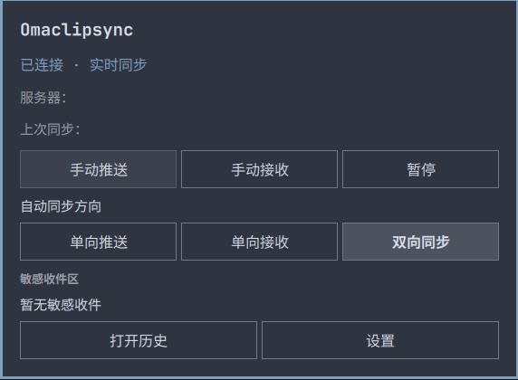
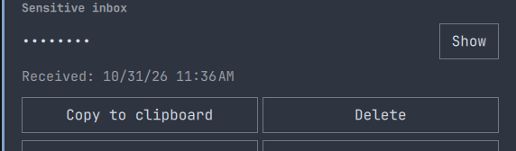
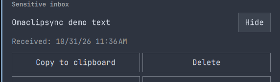
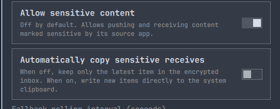

# Omaclipsync

[English](README.md) · 简体中文

<p align="center">
  
</p>

Omaclipsync 是 Omarchy Quattro 的轻量级文本剪贴板客户端插件，使用 [RustClipSync 服务端](https://github.com/Infinifar/rustclipsync-server)的专用协议。同步核心由 Rust 编写，界面融入 Omarchy 顶栏。

可通过[下方多平台客户端](#多平台客户端)与 Windows、Linux 和 Android 设备同步。

当前实现的实际桌面资源占用尚需单独测量。

<p align="center">
  
</p>

截图来自实际运行的英文 Omarchy 插件界面，服务器信息和最近同步时间已遮盖；下方显示的正文仅为无敏感信息的测试文本。

<p align="center"><strong>敏感收件区：默认遮罩</strong><br>
  
</p>
<p align="center"><strong>手动显示：仅使用测试文本</strong><br>
  
</p>
<p align="center"><strong>接收方式设置</strong><br>
  
</p>

仅支持当前 RustClipSync 协议，不提供协议选择项或 SyncClipboard 兼容传输；HTTP 接口统一使用 `/api/...` 前缀。


本版本要求**协议 3**，配套**服务端 3.0.0**、独立桌面端 **0.5.0** 和共享 core **0.4.0**。移动端及 Fcitx 输入法单独发布，升级共享服务端前请确认它们的协议支持；旧客户端需使用服务端 2.0.0。

## 多平台客户端

以下客户端通过同一套自部署 RustClipSync 服务同步 UTF-8 文本，表中正式版本均支持**服务端 3.0.0／协议 3**：

| 平台 | 客户端与下载 | 说明 |
| --- | --- | --- |
| Omarchy Quattro，x86_64 | [Omaclipsync 0.4.1](https://github.com/Infinifar/omaclipsync/releases/tag/v0.4.1) | 顶栏插件，需要 Wayland data-control 支持。 |
| Windows 11，x64 | [RustClipSync Desktop 0.5.0](https://github.com/Infinifar/rustclipsync-desktop/releases/tag/v0.5.0) | WinUI 3 界面；目前 Windows 安装程序尚未签名。 |
| Linux，x86_64 | [RustClipSync Desktop 0.5.0](https://github.com/Infinifar/rustclipsync-desktop/releases/tag/v0.5.0) | 提供 Debian 12、Ubuntu 24.04、Fedora 43 和 Arch 安装包；支持 X11，以及提供 data-control 的 Wayland。缺少该协议的 GNOME Wayland 不支持。 |
| Android 12+，ARM64／x86_64 | [RustClipSync Mobile 0.2.0](https://github.com/Infinifar/rustclipsync-mobile/releases/tag/v0.2.0) | 独立应用，无需更换输入法。 |
| Android，ARM64 | [Fcitx5 RustClipSync Keyboard 0.1.5](https://github.com/Infinifar/fcitx5-android-bibi-keyboard/releases/tag/0.1.5) | 输入法分支内置同步模块；上游 Fcitx5 安装包不包含该模块。 |
| iPhone／iPad | [RustClipSync Mobile 项目](https://github.com/Infinifar/rustclipsync-mobile) | Swift／SwiftUI 客户端仍在开发，尚无 iOS 正式版本。 |

各设备配置相同的 HTTPS 服务端基础地址与账户即可。地址末尾不要手动添加 `/api`，客户端会自行拼接接口路径。这些项目目前尚未提供 macOS 客户端正式版。

同一台 Omarchy 电脑的剪贴板同步选择本插件或独立桌面端之一；同一台 Android 设备选择独立应用或输入法同步模块之一，避免多个客户端同时写入剪贴板。

独立 Android 应用在前台手动推送；自动接收需要开启后台运行。后台捕获新的复制内容还需 Shizuku 13+，并通过无线调试／ADB shell 模式启动；接收无需 Shizuku。Android 及厂商的后台限制仍然适用，详见[移动端使用说明](https://github.com/Infinifar/rustclipsync-mobile#connect-and-sync)。

## 特点

- **实时接收，事件驱动推送**：本机复制由 Wayland data-control 事件触发；远端变化通过 HTTPS 长轮询通知，随后读取最新内容。
- **自动恢复**：实时连接中断后回退到低频轮询；默认 60 秒，可设置 30–300 秒。后台按退避策略重连，恢复后立即检查最新内容。
- **融入桌面**：顶栏显示连接状态，面板提供推送、接收和暂停；支持中文和英文随系统语言切换。
- **同步方向**：主面板可选单向推送、单向接收或双向自动同步（默认）。手动收发同样遵守方向；暂停会阻止推送和接收。
- **可选的本地历史**：默认关闭，可浏览、复制、粘贴和收藏最多 5 条；收藏置顶，清空普通历史时保留。启用后内容以明文保存在本机，也可以使用系统剪贴板历史代替。
- **同步通知**：默认开启，可在设置中关闭。成功推送或接收新文本时显示通知，不包含剪贴板正文；内容未变化或同步失败时不提示成功。
- **敏感内容策略与收件区**：默认不推送或接收应用标记的敏感内容。开启后可选择仅存入加密收件区，或自动写入系统剪贴板；收件区只保留最新一条，默认遮罩，提供显示、收到时间、复制和删除。普通历史不保存标记为敏感的正文。
- **过滤与去重**：支持正则黑名单、白名单和可选的接收过滤；按消息 ID 与每台设备的持久游标避免重试和通知造成重复写入。相同文本的不同复制事件仍可同步。

如果通知没有弹出，可以运行 `omarchy shell notifications isDnd` 检查 Omarchy 的勿扰模式。在 Omarchy 4.5.0 RC 中，开启勿扰时通知会保留在通知历史中，但不会弹窗。可在 Omarchy 中关闭勿扰，或运行 `omarchy shell notifications setDnd off` 恢复弹窗。

## 保存策略后的存储错误恢复

暂停或切换方向已保存，但加密状态清理失败时，界面保留已保存的选择，同步保持阻断；旧会话不能继续上传或重启监听。插件每 30 秒重新读取已保存配置并重试清理，清理成功前不能用“恢复同步”覆盖原限制。修复本机存储或权限问题后等待重试，或重新保存设置触发重试。失败会明确提示，不会显示切换成功；不会重置配对、历史或收件区。

## 使用前须知与限制

### 同时使用其他剪贴板同步软件

**同一组设备只启用一套剪贴板同步通道。** 请关闭其他工具中重叠的剪贴板共享功能，例如联想超级互联 / Smart Connect、Windows 云剪贴板、手机互联、KDE Connect 或远程桌面剪贴板重定向；这些工具的其他功能可以继续使用。多台设备各运行一个 RustClipSync 客户端是正常用法，同一台设备应避免同时运行多个同步客户端。

其他工具转发文本时可能丢弃或替换 RustClipSync 的剪贴板来源标记。文本回到客户端后，可能被当作一次新的本地复制，生成新的消息 ID 并再次上传，形成跨设备循环，表现为持续接收、推送和通知。消息 ID 与游标去重无法阻止已经重新编号的复制事件；当前不能保证与其他同步工具同时使用时可靠防回环。

如出现循环，请先暂停受影响客户端的同步，关闭重叠的剪贴板共享通道，再逐台恢复，并用一条不含敏感信息的测试文本验证。请使用同步暂停／关闭开关；仅关闭窗口可能仍保留后台同步。

### 依赖与限制

- 需要自行部署 [RustClipSync 服务端](https://github.com/Infinifar/rustclipsync-server)。插件不包含服务端；其他设备可按[多平台客户端表格](#多平台客户端)选择客户端。
- **仅同步 UTF-8 文本**，不支持同步图片或文件。Omarchy 默认提供的 [LocalSend](https://localsend.org/) 已经可用于手动在设备间传输图片和文件。
- 暂不支持多账户和 WebDAV；一次只配置一个服务端账户。
- 本插件需要 Linux、Omarchy Quattro / Quickshell 和支持 data-control 协议的 Wayland 合成器。当前预编译包仅支持 **x86_64**；不支持 X11/XWayland、Windows 或 macOS。
- 多屏、长期稳定性及所有桌面环境尚未完整验收。请参阅 [验收记录](ACCEPTANCE.md)。

## 安装

**依赖**：可用的 Secret Service 密钥环及 `secret-tool`；通知需要 Omarchy 通知服务和 `omarchy notification send`；自动同步需要原生 data-control 监听；历史条目的自动粘贴需要 `wtype`。使用 Git 安装还需要 Git 和受信任的 HTTPS 服务器。

为了让通知历史也能显示 Omaclipsync 图标，请在安装插件后将附带的图标安装到用户图标主题：

```sh
install -Dm644 "$HOME/.config/omarchy/plugins/io.github.infinifar.omaclipsync/assets/omaclipsync-icon.svg" "$HOME/.local/share/icons/hicolor/scalable/apps/io.github.infinifar.omaclipsync.svg"
gtk-update-icon-cache -ft "$HOME/.local/share/icons/hicolor"
```

实时通知还会直接提供插件自带的图标。卸载后如果不再需要，可自行删除安装的图标文件。`gtk-update-icon-cache` 由 GTK 提供；安装后桌面会话可能需要重新加载图标主题。

插件运行在未沙箱化的 Omarchy shell 中，具有当前用户权限；请先审阅源码及仓库内的 x86_64 预编译二进制。

可从源码打包，并自行备份、部署和启用：

```sh
./scripts/package.sh
```

打包命令会覆盖 `dist/` 内同版本的输出；请先备份需要保留的安装包。也可使用 Git 安装：

```sh
omarchy plugin add https://github.com/Infinifar/omaclipsync.git --enable
```

### 手动部署插件安装包

仅在 服务端和其他客户端已准备好后执行。下面的命令由用户执行，会停止当前插件，将其目录移到用户数据目录中的备份位置，再加载新包；手动部署后的插件不再是 Git 管理的安装。配置、历史和密钥环位于插件目录之外，需按自己的备份策略另行保护。把 `PACKAGE` 改为已验证的插件安装包绝对路径：

```sh
(
  set -eu
  plugin_id='io.github.infinifar.omaclipsync'
  load_root="${XDG_CONFIG_HOME:-$HOME/.config}/omarchy/plugins"
  backup_root="${XDG_DATA_HOME:-$HOME/.local/share}/omaclipsync-backups"
  package='/absolute/path/to/omaclipsync-plugin.tar.gz'
  test -f "$package" && test -d "$load_root/$plugin_id"
  mkdir -p "$backup_root"
  backup=$(mktemp -d "$backup_root/$plugin_id.XXXXXXXX")
  printf '当前插件将备份到：%s/previous\n' "$backup"
  omarchy plugin disable "$plugin_id"
  mv "$load_root/$plugin_id" "$backup/previous"
  mkdir -p "$load_root/$plugin_id"
  tar -xzf "$package" -C "$load_root/$plugin_id"
  omarchy plugin validate "$load_root/$plugin_id"
  omarchy-shell shell rescanPlugins
  omarchy plugin enable "$plugin_id"
)
```

请记下输出的备份路径。如果验证或启用失败，保留该备份并检查错误；不要重复移动备份。

插件 ID 为 `io.github.infinifar.omaclipsync`。安装源包含 `bin/syncclipd` 和 `bin/syncclipctl`；启用后会运行守护进程，安装时不另行下载二进制或启动第二个 Quickshell。

## 配置和使用

1. 在顶栏打开 Omaclipsync，进入 **设置**，填写 服务端的 HTTPS 地址、用户名和密码并保存。URL 必须指向服务根地址，包括部署时配置的路径前缀（如有）。
2. 密码保存到系统 Secret Service 密钥环，不写入配置文件；留空会保留当前账户已有密码。密钥环锁定时请先解锁。
3. 首次配对从服务端当前版本开始，不覆盖旧的本地内容；启动时已有的本机剪贴板也不会自动推送。离线补发受服务端管理窗口限制，每设备最多一条满足接收条件的最新消息，本地待发送内容与远端冲突时不会静默覆盖；确认后点击 **推送** 可选择当前本地剪贴板。面板也提供 **接收** 和 **暂停**。
4. 在设置中按需启用历史和过滤。选择历史条目会改变系统剪贴板，开启同步时可能被推送到服务器。粘贴会向打开历史前的应用发送 Shift+Insert；如果原窗口不可用，则仅复制并提示。

### 敏感收件区

在设置中开启 **允许同步敏感内容**，再通过 **自动写入收到的敏感内容** 选择接收方式：

- **关闭自动写入**：收到的敏感文本只存入本机加密收件区，不改系统剪贴板。默认采用此方式；新条目替换上一条，普通文本不会清空收件区，关闭本地历史也可使用。
- **开启自动写入**：新的敏感文本直接写入系统剪贴板，保留敏感标记，不另存收件区或普通历史。切换方式不会补写、清除已有收件项或重置设备身份和游标。

收件区位于主页同步方向下方，历史和设置入口仍在最后一栏。正文默认遮罩，点击右侧 **显示** 才读取；关闭面板、进入其他页面、后台断开或收到新条目时重新隐藏。预览最多读取并显示开头 64 KiB，面板最多显示四行；**复制到剪贴板** 始终由 Rust 复制完整原文并携带敏感标记，不触发自动重复推送。收到时间使用当前系统语言和本机时区。

**删除** 仅删除本机当前收件项，不删除服务端内容或已复制到系统剪贴板的内容，也不会导致旧条目再次收到。显示、复制和删除都校验消息 ID；条目已经更新时，旧请求会被拒绝。

主面板和历史面板可以从顶栏打开，也可运行以下命令；快捷键由用户自行配置，插件不会自动修改键位。在历史面板中点击 **返回** 可进入主面板：

```sh
omarchy shell io.github.infinifar.omaclipsync open
omarchy shell io.github.infinifar.omaclipsync openHistory
```

例如，在适用的 Omarchy Hyprland Lua 绑定配置中，可先检查快捷键冲突，再添加以下历史面板快捷键：

```lua
o.bind("SUPER + ALT + H", "Omaclipsync history", "omarchy shell io.github.infinifar.omaclipsync openHistory")
```

如果希望使用 `Super + Alt + C` 循环切换自动同步方向，请先检查快捷键冲突，再自行添加：

```lua
o.bind("SUPER + ALT + C", "Cycle Omaclipsync direction", "omarchy shell io.github.infinifar.omaclipsync cycleDirection")
```

快捷键按单向推送 → 单向接收 → 双向同步循环，并在屏幕下方的 Omarchy OSD 中显示保存后的方向。自动同步暂停时，OSD 也会显示暂停状态。插件不会自动添加或修改快捷键。

设置中的 **显示顶栏图标** 默认开启。关闭后只隐藏图标，服务继续运行。建议隐藏前先配置历史快捷键，以便打开历史面板、返回设置并重新显示图标。请保留 Omaclipsync 在顶栏布局中的组件：移除组件或禁用插件不同于隐藏图标，可能导致面板无法打开。

也可以直接打开主面板，在设置中重新开启 **显示顶栏图标**：

```sh
omarchy shell io.github.infinifar.omaclipsync open
# 或者：
omarchy shell shell summon io.github.infinifar.omaclipsync '{}'
```

也可以不打开面板，直接请求显示或隐藏图标：

```sh
omarchy shell io.github.infinifar.omaclipsync showIcon
omarchy shell io.github.infinifar.omaclipsync hideIcon
```

这些命令返回 `queued` 表示请求已发出，不代表更改已经完成。即使守护进程离线，也可以排队请求，尝试通过 `showIcon` 恢复图标；这两个请求都要求组件仍保留在顶栏布局中才会生效。

隐藏图标模式已实现，但尚未在实际桌面验证。

其他命令：

```sh
omarchy shell io.github.infinifar.omaclipsync status
omarchy shell io.github.infinifar.omaclipsync push
omarchy shell io.github.infinifar.omaclipsync pull
omarchy shell io.github.infinifar.omaclipsync toggle
```

`queued` 表示命令已排队，不代表同步已经成功。`bin/syncclipctl` 也可连接现有 shell，支持 `status`、`push`、`pull`、`toggle`、`watch` 和 `config`。插件不提供重复写入已处理消息的强制接收。

## 权限、网络与数据

插件以当前用户权限读取和写入普通 Wayland 剪贴板，向**用户配置的 HTTPS 服务**发送或接收文本。默认校验证书，只有在设置中显式开启 `insecure` 才会关闭校验；请求不跟随重定向。通知通过最多 25 秒的 HTTPS 长轮询实现，断线后按退避间隔重试。

同步内容上限为 10 MiB，元数据上限为 16 KiB。自动和手动推送以及接收默认跳过应用标记的敏感内容；开启后按设置存入加密收件区或写入系统剪贴板。普通历史不会新增标记为敏感的推送或接收正文。检测依赖复制来源提供敏感标记，无法识别未标记的秘密内容。更改敏感同步开关时会丢弃等待处理的剪贴板事件并重启监听。插件无法使用原生监听时会暂停同步，避免无法识别自身写入造成循环。

敏感收件正文与设备游标一起保存到 AES-GCM 加密状态中，密钥保存在 Secret Service。后台状态和通知不包含正文，显示、复制和删除操作只访问本机，不增加服务端轮询。自动写入或手动复制会附带密码管理器敏感标记；支持该标记的系统历史管理器可能不保存它，但其他应用仍可读取当前剪贴板。HTTPS 保护传输，服务端仍可读取正文。

| 数据 | 默认位置 | 说明 |
| --- | --- | --- |
| 配置 | `~/.config/omaclipsync/config.json` | 文件权限 `0600`，不包含密码 |
| 密码 | 当前用户的 Secret Service 密钥环 | 按服务器用户名保存 |
| 设备令牌、待发送内容和当前敏感收件项 | `~/.local/state/omaclipsync/v1-*.state` | AES-GCM 加密，密钥存于 Secret Service；不包含管理员密码 |
| 本地历史 | `~/.local/share/omaclipsync/history.json` | 默认关闭；启用后明文保存，权限 `0600`，默认 50 条、最多 1000 条，文件上限 16 MiB |
| 日志 | `~/.local/state/omaclipsync/` | JSONL，权限 `0600`；记录固定事件，不记录密码和正文，按 UTC 日期保留 7 天 |

设置了 `XDG_CONFIG_HOME`、`XDG_DATA_HOME` 或 `XDG_STATE_HOME` 时，相应路径以这些目录为准。关闭历史后不会读取或写入历史文件，但已有文件不会自动删除。历史收藏不计入普通历史条数上限；所有记录仍受 16 MiB 文件上限约束。

## 卸载

```sh
omarchy plugin disable io.github.infinifar.omaclipsync
omarchy plugin remove io.github.infinifar.omaclipsync
```

移除插件不会自动删除配置、历史、日志或密钥环项，请按需自行清理。手动复制安装的目录在某些 Omarchy 版本中可能被移至隐藏备份；请留意命令输出。

## 从源码构建

RustClipSync 同步逻辑在相邻的 `rustclipsync-core` 项目中统一维护。本仓库的 `core/vendor/rustclipsync-core` 是自动导出的源码快照，`UPSTREAM.json` 记录逐文件校验值，因此单独克隆插件也能编译。更新共享核心后运行 `bash scripts/sync-core.sh` 重新导出，增加 `--check` 可核对是否完全一致；不要直接编辑快照。

需要 Rust、Cargo、Clippy、`jq` 和 GNU `tar`；集成测试还需要 Python 3 和 OpenSSL。在源码目录运行：

在已安装 `qmllint` 的 Omarchy 机器上，可运行 `./scripts/qmllint.sh` 做 QML 静态检查。脚本通过临时目录解析已安装的 shell 模块，遇到警告时返回失败，不修改已安装的 shell 或插件目录。非标准安装可设置 `OMARCHY_PATH`；可通过 `QMLLINT` 指定可执行文件。静态检查通过不能代替桌面测试。

```sh
cargo test --manifest-path core/Cargo.toml --locked
gjs tests/inbox.test.js Inbox.js
cargo clippy --manifest-path core/Cargo.toml --locked --all-targets -- -D warnings
cargo build --manifest-path core/Cargo.toml --locked --bin syncclipd
# 在隔离 Wayland 合成器中设置 RCS_TEST_DISPOSABLE_WAYLAND=1 后，可执行：
python3 core/tests/sync_e2e.py "$PWD/core/target/debug/syncclipd" /path/to/rustclipsync-server
./scripts/package.sh
omarchy plugin validate "$PWD"
```

打包输出位于 `dist/`；测试使用隔离的本地服务。更多验证和已知限制见 [验收记录](ACCEPTANCE.md)。

## 许可证

[MIT](LICENSE)。Rust 依赖许可证与声明见 [THIRD_PARTY_NOTICES.md](THIRD_PARTY_NOTICES.md)。原生剪贴板监听使用 [wl-clipboard-rs](https://docs.rs/wl-clipboard-rs/0.9.5/wl_clipboard_rs/watch/index.html)。

## 方向上报与协议兼容

本客户端要求协议 **3**（`X-RCS-Protocol: 3`），必须与服务端及其他客户端配套升级；旧客户端继续使用旧服务端。版本不匹配时停止同步并明确提示升级。

连接、重连后先上报最新方向，等待 ACK 后才接收；方向变更立即上报，共享核心 WS 控制通道失败时使用认证 HTTP 降级。本地方向和敏感过滤始终保留，未知或未确认方向不允许接收。暂停保留选择的方向和配对，但禁止收发；手动操作也服从同一策略。

正常关闭后台或断开 socket 只表示离线，保留服务端补发资格。显式重新配对、更换账户或服务端前先撤销旧方向会话，失败时显示未确认并保留原身份。服务端在方向状态闲置 30 天后使其失效。重连确认最新方向后，每设备最多补发一条符合条件的消息；补发时间窗口及关闭选项只由服务端管理页面决定，客户端不硬编码。详见[方向协议](https://github.com/Infinifar/rustclipsync-server/blob/main/docs/DIRECTION-PROTOCOL.md)。

### 从旧服务端迁移

新旧服务端和客户端必须成套切换。旧实例没有方向撤销接口时，先用其管理员或旧版客户端撤销旧设备令牌，再明确执行：

```bash
syncclipctl forget-pairing --confirm-remote-revocation-unconfirmed
```

此命令需要插件正在运行，只排队一个明确确认的本地清除操作，之后请查看状态。它会移除本机设备令牌、待发送项及敏感收件区，保留历史和密钥环项；不会声称远端已撤销，旧令牌仍可能授权，必须由旧管理员撤销。然后再配置新服务端并配对。协议错误不能视为撤销成功。

HTTP 降级使用 30 秒在线租约，与管理页活动标记独立。服务端窗口为 0 仅关闭离线存储和补发，符合方向的在线设备仍能实时收发。

### 自动上传冲突

从 0.4.0 开始，自动上传被拒绝后会持久化取消旧上传和已排队的复制，跳过当时的远端消息，并保留系统剪贴板，不再停留在 `conflict` 等待重启。不会抬高旧文本的版本或重传它；恢复期间已观察到的监听事件也会丢弃，恢复后的新复制正常同步。断网或重启后继续同一取消／跳过流程。日志使用固定的 `conflict_skipped` 事件，不记录正文或凭据。存储、epoch 和凭据错误继续安全停止。
