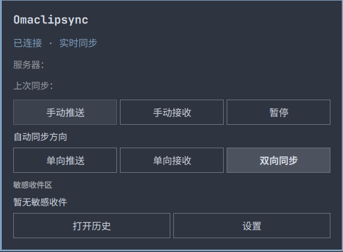

# Omaclipsync

English · [简体中文](README-ZH.md)

<p align="center">
  
</p>

Omaclipsync is a lightweight text clipboard client plugin for Omarchy Quattro, compatible with [SyncClipboard](https://github.com/Jeric-X/SyncClipboard). Its synchronization core is written in Rust and its interface lives in the Omarchy bar.

In testing, the Omaclipsync Rust daemon peaked at about **7.25 MiB** and averaged **0.022% CPU** over nine minutes. This excludes the memory used by the shared Omarchy shell.

<p align="center">
  
</p>

The screenshot shows the running plugin; the server address and last synchronization time have been removed for privacy.

## Features

- **Real-time receive and event-driven push**: local copies use Wayland data-control events. SignalR over WebSocket notifies the client of remote changes, which it then retrieves and validates over HTTPS.
- **Automatic recovery**: when the real-time connection is unavailable, the client falls back to polling every 60 seconds by default, configurable from 30 to 300 seconds. Older values below 30 seconds are treated as 30 seconds. Reconnection uses backoff and checks the latest state immediately after reconnecting.
- **Desktop integration**: bar status and controls for push, receive, and pause, with live English and Chinese translations.
- **Optional local history**: off by default; browse, copy, paste, and favorite up to five entries. Favorites stay at the top and survive clearing ordinary history. Enabled history is stored as plaintext; system clipboard history can be used instead.
- **Filtering and deduplication**: regex blacklist or whitelist, optional filtering on receive, and a default five-minute deduplication window. Manual forced receive is available.

## Requirements and limitations

- Deploy your own [SyncClipboard server](https://github.com/Jeric-X/SyncClipboard), or use an existing compatible server. This plugin does not include a server.
- **UTF-8 text only**: image and file synchronization are not supported. [LocalSend](https://localsend.org/), included in standard Omarchy installations, can already transfer images and files manually between devices.
- Multiple accounts and WebDAV are not currently supported; configure one SyncClipboard server account at a time.
- Requires Linux, Omarchy Quattro / Quickshell, and a Wayland compositor with data-control support. The bundled binaries target **x86_64** only. X11/XWayland, Windows, and macOS are not supported.
- This is a development release; multi-monitor behavior, long-term stability, and all desktop environments have not been fully validated. See [acceptance notes](ACCEPTANCE.md).

## Install

**Dependencies**: an available Secret Service keyring and `secret-tool`; `wl-paste` is needed if native clipboard watching is unavailable; `wtype` is needed for automatic pasting from history. Git installation also requires Git and a trusted HTTPS server.

Plugins run as unsandboxed code with your user's permissions inside Omarchy shell. Review the source and bundled x86_64 binaries before installing and enabling:

If upgrading from the old `omaclipsync` plugin ID, first disable it to prevent two clients from syncing or writing history at the same time:

```sh
omarchy plugin disable omaclipsync
```

Then install and enable the new plugin:

```sh
omarchy plugin add https://github.com/Infinifar/omaclipsync.git --enable
```

The plugin ID is `io.github.infinifar.omaclipsync`. The repository includes `bin/syncclipd` and `bin/syncclipctl`. Enabling it runs the bundled daemon; installation does not download a separate binary or start a second Quickshell.

When upgrading, the configuration, history, logs, and keyring entries keep their existing `omaclipsync` locations and identifiers. Update any shortcut that invokes the old IPC target to use `io.github.infinifar.omaclipsync`.

## Setup and use

1. Open Omaclipsync in the bar, choose **Settings**, and save the server HTTPS URL, username, and password. Include the deployment's URL path prefix if one is configured.
2. The password is stored in the user's Secret Service keyring, not in the configuration file. Leaving the password blank keeps the existing password for that account; unlock the keyring if needed.
3. Local copies are pushed and remote changes received automatically while synchronization is enabled. The clipboard present at startup is not pushed automatically; use **Push** when needed. **Receive** and **Pause** are also available.
4. Enable local history and filters if desired. Selecting a history entry changes the system clipboard and may push it to the server when synchronization is enabled. Paste sends Shift+Insert to the application active before opening history; if that window is unavailable, the item is copied and a notification is shown.

Open history from the bar or bind this command yourself; the plugin does not automatically change keybindings:

```sh
omarchy shell io.github.infinifar.omaclipsync openHistory
```

For example, after checking for shortcut conflicts, add this to a compatible Omarchy Hyprland Lua binding configuration:

```lua
o.bind("SUPER + ALT + V", "Omaclipsync history", "omarchy shell io.github.infinifar.omaclipsync openHistory")
```

**Show bar icon** is enabled by default in Settings. Turning it off hides the icon while the service continues to run. Configure a history shortcut before hiding the icon so you can open history and return to Settings to show it again. Keep the Omaclipsync widget in the bar layout: removing it or disabling the plugin is different from hiding its icon and may make the panel unavailable.

You can also open the main panel directly and re-enable **Show bar icon** in Settings:

```sh
omarchy shell io.github.infinifar.omaclipsync open
# Alternatively:
omarchy shell shell summon io.github.infinifar.omaclipsync '{}'
```

To request that the icon be shown or hidden without opening the panel:

```sh
omarchy shell io.github.infinifar.omaclipsync showIcon
omarchy shell io.github.infinifar.omaclipsync hideIcon
```

These commands return `queued` when the request is sent, not when the change has completed. They can be queued even if the daemon is offline, so `showIcon` can be used to attempt recovery; the widget must still be present in the bar layout for either request to take effect.

The hidden-icon mode is implemented but has not yet been verified on a running desktop.

Other commands:

```sh
omarchy shell io.github.infinifar.omaclipsync status
omarchy shell io.github.infinifar.omaclipsync push
omarchy shell io.github.infinifar.omaclipsync pull
omarchy shell io.github.infinifar.omaclipsync pullForce
omarchy shell io.github.infinifar.omaclipsync toggle
```

`queued` means that a command was queued, not that synchronization succeeded. The bundled `bin/syncclipctl` connects to the existing shell and supports `status`, `push`, `pull [--force]`, `toggle`, `watch`, and `config`.

## Permissions, network, and data

The plugin runs with the current user's permissions, reads and writes the regular Wayland clipboard, and exchanges text with the **user-configured HTTPS server**. TLS certificate validation is on by default and can only be disabled by explicitly enabling `insecure`. HTTP and SignalR negotiation do not follow redirects. SignalR negotiation honors system proxy environment variables, while WebSocket currently connects directly; networks requiring a proxy may fall back to polling.

Text is limited to 10 MiB; metadata and SignalR messages are limited to 256 KiB. Long text uses the server's text data endpoint. Automatic monitoring skips selections marked sensitive by password managers; manual push does not apply that protection, so check what you send. When falling back to `wl-paste --watch`, the first data event may be ignored if the initial clipboard snapshot cannot be read, to avoid overwriting the server.

| Data | Default location | Behavior |
| --- | --- | --- |
| Configuration | `~/.config/omaclipsync/config.json` | Mode `0600`; contains no password |
| Password | User's Secret Service keyring | Stored per server username |
| Local history | `~/.local/share/omaclipsync/history.json` | Off by default; plaintext when enabled, mode `0600`, default 50 entries, maximum 1000, file limit 16 MiB |
| Logs | `~/.local/state/omaclipsync/` | JSONL, mode `0600`; fixed events only, no password or clipboard text, retained for 7 UTC dates |

The corresponding `XDG_CONFIG_HOME`, `XDG_DATA_HOME`, and `XDG_STATE_HOME` override these paths. Disabling history stops reading and writing it but does not delete existing data. Favorites do not count toward the ordinary entry limit; the 16 MiB file limit still applies to all entries.

## Uninstall and rollback

```sh
omarchy plugin disable io.github.infinifar.omaclipsync
omarchy plugin remove io.github.infinifar.omaclipsync
```

Uninstalling the plugin does not automatically delete configuration, history, logs, or keyring entries; remove those separately if desired. Some Omarchy versions move a manually copied plugin directory to a hidden backup; check the command output. Before re-enabling the old `omaclipsync` plugin, first disable the new plugin to avoid running both clients. Before rolling back to v0.1.1, back up the history file and remove all favorites: that version cannot read history containing favorite fields.

## Build from source

Requires Rust, Cargo, Clippy, `jq`, and GNU `tar`; integration tests also require Python 3 and OpenSSL. From the repository root:

```sh
cargo test --manifest-path core/Cargo.toml --locked
cargo clippy --manifest-path core/Cargo.toml --locked --all-targets -- -D warnings
cargo build --manifest-path core/Cargo.toml --locked --bin syncclipd
python3 core/tests/signalr_e2e.py "$PWD/core/target/debug/syncclipd"
python3 core/tests/offline_recovery.py "$PWD/core/target/debug/syncclipd"
./scripts/package.sh
omarchy plugin validate "$PWD"
```

Artifacts are written to `dist/`; the integration tests use isolated local services. See [acceptance notes](ACCEPTANCE.md) for further validation and limitations.

## License

[MIT](LICENSE). Rust dependency licenses and notices: [THIRD_PARTY_NOTICES.md](THIRD_PARTY_NOTICES.md). The protocol implementation references [SyncClipboard upstream](https://github.com/Jeric-X/SyncClipboard) (reviewed at `fd25fd62409967a69cec842cabaec2c00adf901d`); native clipboard watching uses [wl-clipboard-rs](https://docs.rs/wl-clipboard-rs/0.9.5/wl_clipboard_rs/watch/index.html).
